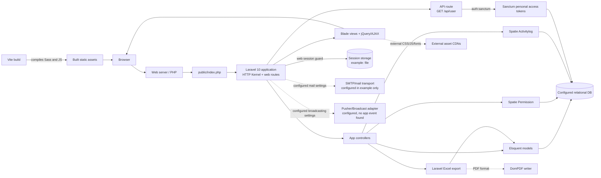

# Aluth Gamak Aluth Ratak — Architecture

> Evidence-based architecture notes for the repository as inspected on 2026-11-19.
> This describes the current implementation, not a proposed redesign. “Confirmed”
> means the behavior or component is directly visible in application code or
> configuration; “inferred” marks likely framework/runtime behavior not confirmed
> by a successful route inventory or deployment environment.

## 1. Project Overview

### 3–5 minute project overview

Aluth Gamak Aluth Ratak is a Ministry of Home Affairs performance-agreement
tracking application. District-level users submit annual tasks, indicators,
targets, and quarterly progress. The application provides a dashboard, role and
user administration, internal messaging, audit history, and CSV/Excel/PDF
exports. That purpose and feature list are stated in the [README](../README.md#L1)
and align with the forms, controllers, and models described below.

It is a **single Laravel 10 server-rendered monolith**, not a separately deployed
frontend/backend or microservice system. Browser pages are Blade templates;
HTTP handling, authentication, business logic, and Eloquent persistence all run
in the Laravel application. The only route in `routes/api.php` is a Sanctum
authenticated current-user endpoint; most browser interactions use the
session-backed `web` routes, including JSON/AJAX endpoints. See
[web routes](../routes/web.php#L28) and [API routes](../routes/api.php#L17).

### Main technologies

- PHP `^8.1.25`, Laravel `^10.10`, Laravel UI, and Sanctum are declared in
  [composer.json](../composer.json#L8).
- MySQL is the example/default database, accessed through Laravel Eloquent and
  migrations; configuration also defines SQLite, PostgreSQL, and SQL Server
  connections ([database config](../config/database.php#L18)).
- Blade, Sass, Bootstrap, JavaScript, Axios, and Vite make up the browser
  interface/build chain ([package.json](../package.json#L4),
  [Vite config](../vite.config.js#L1), [layout](../resources/views/layouts/app.blade.php#L19)).
- Spatie Permission and Activitylog provide role/permission checks and audit
  records; Laravel Excel and DomPDF packages support exports
  ([composer.json](../composer.json#L10)).

### Architecture style and runtime

- **Confirmed:** MVC-style Laravel application with route declarations,
  controllers, Eloquent models, Blade views, middleware, and migrations.
- **Not present as separate layers:** no app-owned `Services/` or
  `Repositories/` directory; controllers perform queries, authorization checks,
  writes, and response construction directly.
- **Runtime boundary:** web server routes requests through
  [public/index.php](../public/index.php#L1), Composer autoloading, the
  [bootstrap application](../bootstrap/app.php#L1), and Laravel's HTTP kernel.
- **Build/runtime environments:** `.env.example` documents local PHP/Laravel,
  MySQL, file sessions, sync queues, and Vite settings
  ([environment example](../.env.example#L1)). The actual `.env` was not read.
  The README documents `php artisan serve` for local use
  ([README setup](../README.md#L74)).

### Technical decisions visible in code

- Keep UI and backend in one deployable application using Blade forms and
  `@vite`, rather than a standalone SPA ([layout](../resources/views/layouts/app.blade.php#L19)).
- Use Laravel's session guard for browser authentication and Spatie for
  role/permission checks ([auth config](../config/auth.php#L16),
  [User model](../app/Models/User.php#L22)).
- Use Eloquent models and database migrations as the data boundary; no explicit
  repository abstraction is implemented.
- Keep performance-agreement records owned by a user (`user_id`) and apply
  role-dependent filtering in the controller's list/export paths
  ([controller](../app/Http/Controllers/ProcessAgreementController.php#L21)).
- Generate downloads in-process through Laravel Excel; PDF is requested through
  its DomPDF writer ([controller](../app/Http/Controllers/ProcessAgreementController.php#L291)).

### Challenges addressed by the implementation

- Captures quarterly targets and progress across nine business fields using
  shared `process_agreements` records and specialized Blade forms
  ([form controller](../app/Http/Controllers/ProcessAgreementController.php#L111),
  [create view](../resources/views/process_agreements/create.blade.php#L59)).
- Provides role-aware list filtering, role/permission administration, internal
  user messaging, activity logging, and spreadsheet/report exports
  ([role routes](../routes/web.php#L102),
  [message controller](../app/Http/Controllers/MessageController.php#L20)).

## 2. Architecture Diagram

Solid arrows denote relationships confirmed in app code/configuration. Dashed
edges denote configured options or libraries for which there is no corresponding
application event/call path found.

The diagram does **not** imply that Pusher, S3, or an external business API is
used: the environment/configuration supports some of these adapters, but no
application call path was found. The Vite entry points and CDN references are
visible in [vite.config.js](../vite.config.js#L5) and the
[Blade layout](../resources/views/layouts/app.blade.php#L19).

## 3. Directory Structure

| Path | Architectural role |
|---|---|
| `app/Http/Controllers/` | Web request handlers, application logic, Eloquent queries, and response/view selection. Includes agreement, user, role, permission, messages, activity log, home, and Laravel UI auth controllers. |
| `app/Http/Middleware/` | Laravel middleware, including session authentication and the custom `admin` role check. Aliases are registered in [Kernel.php](../app/Http/Kernel.php#L56). |
| `app/Models/` | Eloquent entities: `User`, `ProcessAgreement`, `Message`, `Conversation`, and `Reply`. The latter two have relationships but no matching migrations were found. |
| `app/Exports/` | Laravel Excel export implementation: query and map process agreements to export rows. |
| `app/Providers/` | Laravel service providers, including route, auth, event, and Excel provider registration. The app auth provider has no policies. |
| `app/Console/` | Console kernel; schedule method contains no active scheduled task ([Kernel.php](../app/Console/Kernel.php#L13)). |
| `app/Districts.php` | District lookup helper included by controllers; used to populate district selectors. |
| `bootstrap/` | Laravel application and kernel bindings ([bootstrap/app.php](../bootstrap/app.php#L15)). |
| `routes/` | `web.php` contains browser routes; `api.php` contains the Sanctum `/user` route; `console.php` and `channels.php` are Laravel extension points. |
| `database/migrations/` | User, process agreement, message, role/permission, token, failed-job, password reset, and activity-log schema. |
| `database/seeders/`, `database/factories/` | Database seeding and model factory locations. The current seeder's user examples are commented out ([DatabaseSeeder.php](../database/seeders/DatabaseSeeder.php#L11)). |
| `resources/views/` | Server-rendered pages: auth, home, forms, messaging, user/role/permission administration, activity log, and layout. |
| `resources/js/`, `resources/sass/`, `resources/css/` | Browser assets and Vite inputs; the layout also references public assets and third-party CDNs. |
| `public/` | Web document root, front controller, static assets, and Apache rewrite rules ([.htaccess](../public/.htaccess#L6)). |
| `config/` | Laravel configuration and package settings, including auth, database, mail, filesystem, queue, permissions, activity logging, and log viewer. |
| `storage/` | Laravel runtime files/logs and a `backups/` directory. No app-owned backup controller/job/schedule is implemented. |
| `tests/` | PHPUnit Unit and Feature suites. Current tests are framework smoke/example tests, not coverage of business workflows. |
| `Project Showcase/` | Screenshots illustrating user-facing features; this is presentation material, not executable application code. |
| `vendor/`, `node_modules/` | Installed Composer and npm dependencies; excluded from the app-owned architecture inventory. |

No separate frontend project, API service, app-owned service/repository module,
or deployment/CI directory was found. The README is the primary narrative
documentation; the screenshots in `Project Showcase/` are supplementary.

## 4. Request/Data Flow

### Example: create a performance agreement

1. An authenticated user opens the relevant form. The controller's `create()`
   returns `process_agreements.create`
   ([controller](../app/Http/Controllers/ProcessAgreementController.php#L111)).
2. The Blade form posts to the named `process_agreements.store` route with a
   CSRF token ([create view](../resources/views/process_agreements/create.blade.php#L59)).
   The route is in the `auth` group ([web.php](../routes/web.php#L36)).
3. Laravel routes the POST to `ProcessAgreementController::store()`, which
   validates field/task and numeric progress values, assigns `Auth::id()` as
   `user_id`, copies the submitted fields, and calls `save()`
   ([controller](../app/Http/Controllers/ProcessAgreementController.php#L162)).
4. Eloquent persists to `process_agreements`; the `user_id` foreign key points
   to `users` and is nullable/on-delete-set-null
   ([migration](../database/migrations/2024_03_25_045340_create_process_agreements_table.php#L19)).
5. The controller writes an activity entry and redirects to
   `process_agreements.index` ([controller](../app/Http/Controllers/ProcessAgreementController.php#L194)).
6. `index()` queries through `ProcessAgreement`, limits regular users to their
   own `user_id`, allows admin/super-admin listing, applies filters, paginates
   ten rows, and returns the Blade index
   ([controller](../app/Http/Controllers/ProcessAgreementController.php#L21)).

**Important distinction:** the listing and export paths include ownership
filters, but `show()`, `edit()`, `update()`, and `destroy()` accept a
route-bound agreement without checking the current user or role. The record
ownership boundary is therefore incomplete; see
[authorization findings](#8-authentication-and-authorization).

## 5. Main Components

### Controllers/routes

- `ProcessAgreementController`: form views, list/filter/search, CRUD, activity
  writes, export, and filtered deletion
  ([methods](../app/Http/Controllers/ProcessAgreementController.php#L21)).
- `MessageController`: recipient discovery, message storage/fetching,
  broadcast-to-users, and deletion. Some actions are incomplete or have no
  ownership checks ([methods](../app/Http/Controllers/MessageController.php#L20)).
- `UserController`, `RoleController`, `PermissionController`: CRUD and Spatie
  role/permission assignment ([user controller](../app/Http/Controllers/UserController.php#L17),
  [role controller](../app/Http/Controllers/RoleController.php#L16),
  [permission controller](../app/Http/Controllers/PermissionController.php#L14)).
- `ActivityLogController`: paginated activity list and log detail view
  ([controller](../app/Http/Controllers/ActivityLogController.php#L10)).
- `HomeController`: authenticated dashboard view
  ([controller](../app/Http/Controllers/HomeController.php#L14)).
- `Auth/*Controller`: Laravel UI authentication, registration, password reset,
  and confirmation flows; route registration begins at `Auth::routes()`
  ([routes](../routes/web.php#L32)).

### Services, business logic, data access

- Business logic resides in controllers; no app-owned service or repository
  classes were found.
- Models are Eloquent Active Record entities; controllers construct Eloquent
  queries directly, and the export class separately builds its own query
  ([export](../app/Exports/ProcessAgreementsExport.php#L32)).
- Role/permission behavior is provided by Spatie's traits and middleware,
  not custom authorization policies ([User model](../app/Models/User.php#L22),
  [Kernel aliases](../app/Http/Kernel.php#L69)).

### Models/entities

- `User`: auth principal, profile data, roles, agreements, and messages
  ([model](../app/Models/User.php#L22)).
- `ProcessAgreement`: quarterly performance data, belongs to one user
  ([model](../app/Models/ProcessAgreement.php#L21)).
- `Message`: message data plus sender/receiver/conversation/reply relationships
  ([model](../app/Models/Message.php#L25)).
- `Conversation` and `Reply`: present as model classes, but no matching database
  migrations exist. `Message` also lists `conversation_id` as fillable even
  though the `messages` migration does not add that column.

### UI components and middleware

- Blade pages under `resources/views/` are the UI; `layouts/app.blade.php`
  shares the navbar, sidebar, asset loading, and CSRF metadata.
- Blade `@can` checks hide form controls, but are UI-level checks and do not
  replace controller authorization ([create view](../resources/views/process_agreements/create.blade.php#L12)).
- `CheckAdminRole` accepts `admin` or `super-admin`; the `admin` alias is in
  [Kernel.php](../app/Http/Kernel.php#L83) and middleware implementation in
  [CheckAdminRole.php](../app/Http/Middleware/CheckAdminRole.php#L10).
- Spatie `role`, `permission`, and `role_or_permission` aliases are also
  registered in the HTTP kernel ([Kernel.php](../app/Http/Kernel.php#L69)).

### Utilities, jobs, workers, scheduled tasks

- `Districts.php` supplies district choices.
- `ProcessAgreementsExport` maps Eloquent rows to CSV/Excel/PDF output.
- No app-owned queue jobs/workers or active scheduled tasks were found. The
  example environment uses `QUEUE_CONNECTION=sync`
  ([.env.example](../.env.example#L21)); the scheduler contains only a commented
  example ([Console Kernel](../app/Console/Kernel.php#L13)).

### Unused or partially implemented features

- `ReplyController` and `DatabaseBackupController` are imported by
  `routes/web.php`, but no app-owned implementation files were found. The
  reply route also references the missing `ReplyController`.
- `MessageController::destroy()` is empty. `fetchUserEmailByWorkplace` is
  referenced by a route but is not implemented; `searchMessages`,
  `getUserMessages`, and `updateFieldStatus` are controller methods without
  matching declarations in `routes/web.php`.
- `Conversation`/`Reply` model relationships are not backed by migrations.
- The `activity/logs/{id}` route parameter does not match the typed `$activity`
  method parameter, so implicit model binding may not work as intended
  ([route](../routes/web.php#L98),
  [controller](../app/Http/Controllers/ActivityLogController.php#L16)).
- README claims a REST API, but the app-owned API route file defines only
  `GET /api/user`; most interactive requests use web routes.
- The database seeder's user examples and several older export route examples
  are commented out ([seeder](../database/seeders/DatabaseSeeder.php#L11),
  [routes](../routes/web.php#L68)).

## 6. API Structure

`php artisan route:list --except-vendor` was attempted and **failed** with
`ReflectionException: Class "ProcessAgreementController" does not exist`.
The visible cause is the short string controller route for
`/workplaces/{district}` in [web.php](../routes/web.php#L56), which is not
fully-qualified. The inventory below is therefore based on declared source
routes, not a successful runtime listing. Resource routes expand to Laravel's
standard REST verbs; duplicate declarations are called out explicitly.

| Method / route | Access declaration | Controller/handler | Database or other data access |
|---|---|---|---|
| `GET /` | Public | Inline welcome view ([web.php](../routes/web.php#L28)). | No application database query. |
| Laravel UI auth routes | Public/guest and auth behavior per Laravel UI | Declared via `Auth::routes()`; conventional login, logout, registration, password reset/confirmation routes. Exact registered route list was not verifiable because `route:list` fails ([web.php](../routes/web.php#L32)). | `users`, `password_reset_tokens`, and the configured session store as applicable. |
| `GET /home` | `HomeController` applies `auth` | `HomeController::index` returns `home` ([web.php](../routes/web.php#L34)). | No explicit application query in the controller. |
| `GET /process_agreements` | `auth` | Resource `index`; extra `/index` route is also declared. | `process_agreements`, with `users` for district/name/email searching and role-based scoping. |
| `GET /process_agreements/create` | `auth` | Resource `create`; extra `/create` route is also declared. | No controller query. |
| `POST /process_agreements` | `auth` | `ProcessAgreementController::store`; declared by both resource and explicit route. | Inserts `process_agreements`; activity logger writes `activity_log`. |
| `GET /process_agreements/{process_agreement}` | `auth` | Resource `show`; also explicitly declared. | Loads one `process_agreements` row via route model binding. |
| `GET /process_agreements/{process_agreement}/edit` | `auth` | Resource `edit`; also explicitly declared. | Loads one `process_agreements` row via route model binding. |
| `PUT/PATCH /process_agreements/{process_agreement}` | `auth` | Resource `update`; PUT also explicitly declared. | Updates `process_agreements`; activity logger writes `activity_log`. |
| `DELETE /process_agreements/{process_agreement}` | `auth` | Resource `destroy`; also explicitly declared. | Deletes one `process_agreements` row; activity logger writes `activity_log`. |
| `GET /index`, `GET /create` | `auth` | Same controller index/create; duplicate resource paths. | Index queries agreement/user rows; create has no controller query. |
| `GET /social`, `/poverty`, `/health-and-nutrition`, `/agriculture`, `/environment`, `/government-revenue`, `/public-expenditure`, `/other-details`, `/navigation` | `auth` | Category/navigation Blade views. | No controller database query. |
| `GET /workplaces/{district}` | `auth` | Declared string controller `ProcessAgreementController@getWorkplacesByDistrict`; route enumeration shows unresolved class. | Intended handler queries `users` for distinct workplaces. |
| `POST /process_agreements/delete-filtered` | `auth` | `deleteFiltered`; filters by role/owning user and deletes matching rows. | Deletes matching `process_agreements` rows in a transaction. |
| `GET /download-csv`, `/download-excel`, `/download-pdf` | `auth` | `ProcessAgreementController` and `ProcessAgreementsExport`; non-admin exports pass current user ID. | Queries `process_agreements` and related `users`; writes activity records. |
| `GET /messages`, `/messages/create` | `auth`; controller limits `create` to `admin` middleware | Message list and compose page. | Reads `users`, `messages`, and district/workplace data. |
| `GET /messages/fetch-workplaces`, `/messages/fetch-user-email` | `auth` | `MessageController` JSON selector responses. | Queries `users`. |
| `GET /messages/{userId}`, `/messages/{userId}/messages` | `auth` | Fetches receiver messages; controller does not verify that requested user is the current user. | Queries `messages` by `receiver_id` and optionally district/workplace. |
| `GET /messages/fetch-messages` | `auth` | Same handler as `fetchMessages`, but route supplies no `{userId}` although the method requires it; likely fails when invoked. | Intended query is `messages` by receiver and filters. |
| `POST /messages` | Duplicate declarations in `auth` group; one declaration adds `admin`, a later one does not | `MessageController::store`; route registration is ambiguous and should be reduced to one declaration ([web.php](../routes/web.php#L38)). | Reads recipient from `users`; inserts `messages`; writes `activity_log`. |
| `POST /messages/send-to-all` | `auth` only in route source | `MessageController::sendToAll`; method itself has no admin/super-admin authorization check. | Reads all district `users`; inserts one `messages` row per recipient and activity records. |
| `DELETE /messages/{userId}/delete-all` | `auth` only | `deleteAllMessages`; no role/ownership guard is evident in the method. | Deletes received `messages` rows; writes `activity_log` records. |
| `DELETE /messages/delete-all-users-messages` | `auth`; method checks super-admin | `deleteAllUsersMessages`. | Truncates `messages`; writes an activity entry. |
| `DELETE /messages/{message}` | `auth` | `MessageController::destroy`, currently an empty method. | No implemented database operation. |
| `POST /replies/store` | `auth` | References `App\Http\Controllers\ReplyController@store`; that controller file is absent. | No implemented handler/database access. |
| `GET /activity-logs`, `/activity/logs/{id}` | `auth` only | Activity log list/detail; no admin-role check on these routes. | Reads `activity_log`. |
| `GET/POST /permissions`, `/roles`, `/users`; resource detail/edit/update/delete routes | `role:super-admin|admin` | Standard Laravel resource CRUD declarations, with model/ID parameters; extra GET delete routes and role-permission assignment routes are separately declared. Exact expanded runtime list is unverified because `route:list` fails. | Reads/writes `permissions`, `roles`, their pivot tables, `users`, and `model_has_roles`; activity entries are written in several mutations. |
| `POST /fetch-user-email-by-workplace` | `role:super-admin|admin` | References `MessageController::fetchUserEmailByWorkplace`; that method is absent. | No implemented handler/database access. |
| `GET /api/user` | `auth:sanctum` API middleware | Returns the authenticated user ([api.php](../routes/api.php#L17)). | Reads `users`; personal access tokens are stored in `personal_access_tokens` when token auth is used. |
| `/log-viewer` package routes | Log Viewer config enables routes; middleware is environment-configured and otherwise `null` | Package routes include log listing, detail, download, filter/search, and delete. Review deployment access: [config](../config/log-viewer.php#L59), route map [vendor registrar](../vendor/arcanedev/log-viewer/src/Http/Routes/LogViewerRoute.php#L25). | Reads/deletes files under `storage/logs`, not application database tables. |

The API middleware group throttles requests and substitutes bindings. Sanctum's
stateful frontend middleware is commented out in the
[HTTP kernel](../app/Http/Kernel.php#L40); the configured API route uses
`auth:sanctum`, but the repository does not implement a broader API surface.

## 7. Database Architecture

### Tables found in migrations

- `users`: identity, password, district/workplace/profile fields, verification
  timestamp, remember token, timestamps
  ([migration](../database/migrations/2014_10_12_000000_create_users_table.php#L19)).
- `process_agreements`: nullable `user_id`, field/task/indicator, target,
  quarters, total, percentage, timestamps; user deletion sets `user_id` null
  ([migration](../database/migrations/2024_03_25_045340_create_process_agreements_table.php#L19)).
- `messages`: user/receiver IDs, district/workplace, subject/body/email and
  timestamps; sender and read flag are added by later migrations
  ([create](../database/migrations/2024_04_13_151640_create_messages_table.php#L21),
  [sender](../database/migrations/2024_04_14_200814_add_sender_id_to_messages_table.php#L19),
  [read](../database/migrations/2024_06_01_150523_add_read_column_to_messages_table.php#L19)).
- Spatie permission tables: `permissions`, `roles`, `model_has_permissions`,
  `model_has_roles`, and `role_has_permissions`
  ([migration](../database/migrations/2024_02_19_040409_create_permission_tables.php#L32)).
- Spatie `activity_log` table, including polymorphic subject/causer and JSON
  properties ([migration](../database/migrations/2024_06_02_145321_create_activity_log_table.php#L16)).
- Framework support tables: `personal_access_tokens`, `failed_jobs`,
  `password_reset_tokens`, and the older `password_resets` migration. Auth
  config points password resets at `password_reset_tokens`
  ([auth config](../config/auth.php#L93)).

### Relationships and persistence

- `User` has many process agreements and messages; `ProcessAgreement` belongs to
  a user ([User model](../app/Models/User.php#L52),
  [agreement model](../app/Models/ProcessAgreement.php#L43)).
- `Message` relates to sender, receiver, conversation, and replies
  ([Message model](../app/Models/Message.php#L47)).
- Eloquent is the query/write mechanism. No SQL repository layer or explicit
  database abstraction beyond Laravel's configured connections was found.
- Migrations are the schema source; there is no checked-in generated schema
  snapshot or substantive seeder for production records
  ([DatabaseSeeder.php](../database/seeders/DatabaseSeeder.php#L11)).

### Schema gaps and integrity concerns

- `Conversation` and `Reply` models and message relationships exist, but
  migrations for `conversations`/`replies` were not found. The `messages`
  migration also has no `conversation_id` column, despite that model field
  being fillable. These are partially implemented features.
- Both old `password_resets` and newer `password_reset_tokens` migrations exist;
  config uses the latter. Verify the legacy table is intentional before future
  schema cleanup.
- `messages.user_id`, `receiver_id`, and `sender_id` have cascading user
  deletion semantics; this can erase message history when a user is deleted
  ([messages migration](../database/migrations/2024_04_13_151640_create_messages_table.php#L33)).

## 8. Authentication and Authorization

### Login and identity

- Default guard is `web`, session-based, using the Eloquent `App\Models\User`
  provider ([auth config](../config/auth.php#L16)).
- Laravel UI routes are enabled with `Auth::routes()`; registration validates
  the form, hashes the password, creates a user, and immediately logs that user
  in ([RegisterController](../app/Http/Controllers/Auth/RegisterController.php#L48)).
- Registration is enabled without an approval step and the registration
  controller does not assign a role. Admin-created users receive roles through
  `UserController::store()`; this difference should be intentional and covered
  by tests ([registration](../app/Http/Controllers/Auth/RegisterController.php#L66),
  [admin user creation](../app/Http/Controllers/UserController.php#L49)).
- User has a hashed password cast and hides password/remember token from
  serialization ([User model](../app/Models/User.php#L75)).
- Sanctum tokens are supported by the User model and token migration, but no
  token issuance flow is implemented in app code. Only `GET /api/user` is
  protected by Sanctum.
- Email verification is not required by the User model: the
  `MustVerifyEmail` import is commented out ([User.php](../app/Models/User.php#L5)).

### Roles, permissions, protected areas

- Spatie roles and permissions are used; role and permission resources are
  grouped behind `role:super-admin|admin`
  ([routes/web.php](../routes/web.php#L102)).
- The `admin` middleware allows either `admin` or `super-admin`
  ([CheckAdminRole.php](../app/Http/Middleware/CheckAdminRole.php#L19)).
- Agreement listing and exports scope regular users to their own records; the
  controllers do not apply equivalent checks to agreement show/edit/update/
  destroy by route-bound ID ([ProcessAgreementController.php](../app/Http/Controllers/ProcessAgreementController.php#L204)).
- Some route groups require only `auth`; message-level role/owner checks vary by
  action. Activity logs are readable to every authenticated user in the route
  source.
- `AuthServiceProvider` has an empty policy map
  ([provider](../app/Providers/AuthServiceProvider.php#L12)); views contain
  `@can` checks, but there are no app-owned policies to enforce those rules
  consistently at the server boundary.

### High-risk security concerns (code-based, not penetration-tested)

1. **Potential public log exposure — highest priority.** Log Viewer routes are
   enabled; `ARCANEDEV_LOGVIEWER_MIDDLEWARE` resolves to `null` when unset, and
   `.env.example` does not set it ([log viewer config](../config/log-viewer.php#L59)).
   Confirm production route middleware and require authenticated admin access
   before exposing log contents or deletion.
2. **IDOR / cross-user access.** Agreement route-bound show/edit/update/destroy,
   message fetch-by-user, and delete-all-for-user paths lack consistent owner
   checks. The list/export scoping is not sufficient to protect direct object
   routes ([agreement controller](../app/Http/Controllers/ProcessAgreementController.php#L204),
   [message controller](../app/Http/Controllers/MessageController.php#L100)).
3. **Admin-only intent not enforced consistently.** `sendToAll` and
   `deleteAllMessages` routes require only login; `sendToAll` contains no
   admin-role check. A duplicate `POST /messages` route has conflicting
   middleware, with the later declaration lacking the earlier `admin`
   middleware ([web.php](../routes/web.php#L38),
   [MessageController.php](../app/Http/Controllers/MessageController.php#L215)).
4. **Mass destructive operations.** Filtered agreement deletion is available
   under the general `auth` group and can delete all records matching a user's
   filters; the method scopes records but does not require a stronger
   permission ([controller](../app/Http/Controllers/ProcessAgreementController.php#L368)).
5. **Over-posting/validation coverage.** `UserController::update()` validates
   only some fields but then copies other request fields into the update array;
   validate every updated attribute and role assignment consistently
   ([UserController.php](../app/Http/Controllers/UserController.php#L111)).
6. **CSRF/session and production settings.** Web routes use CSRF middleware;
   production must not use the example's `APP_DEBUG=true` or local credentials
   ([web middleware](../app/Http/Kernel.php#L34),
   [.env.example](../.env.example#L1)). This document did not inspect the
   private `.env`.

These are architectural/code-review findings only. They are not claims that a
specific production deployment is exposed or that an exploit was executed.

## 9. External Integrations

| Integration | Evidence and implementation status |
|---|---|
| Laravel Excel / PhpSpreadsheet | Used by `ProcessAgreementsExport` and controller download methods for CSV/Excel/PDF output ([controller](../app/Http/Controllers/ProcessAgreementController.php#L291), [export](../app/Exports/ProcessAgreementsExport.php#L14)). |
| DomPDF | Dependency is declared and the PDF download selects the Excel DomPDF writer. `Pdf` is imported in the controller but not used directly. |
| Spatie Permission | Used for role/permission database tables, `HasRoles`, route middleware, and `@can` checks. |
| Spatie Activitylog | Used by agreement, user, message, and role/permission operations; stored in database `activity_log`. |
| ArcaneDev Log Viewer | Installed, routes enabled, app-published views present; access middleware is environment-configurable and defaults to `null`. |
| Mail | Laravel mail config and auth password-reset notifications are present; `.env.example` points to SMTP/Mailpit. No custom mail service was found. Production delivery is environment-dependent. |
| Pusher/broadcasting | Environment/configuration keys exist, but no app broadcast events or channels were found; `routes/channels.php` is only the scaffold. |
| Cloud/object storage | Filesystem config supports local/S3 adapters; no application call to `Storage` was found. |
| External APIs/payments/analytics | No application integration code found. Guzzle is a dependency but no app-owned Guzzle/HTTP call site was found. |
| Browser CDNs | Layout/forms load jQuery, Bootstrap, Popper, Bunny Fonts, and Chart.js from external URLs; these are runtime asset dependencies ([layout](../resources/views/layouts/app.blade.php#L22), [agreement chart](../resources/views/process_agreements/show.blade.php#L109)). |

Messaging is application-internal and persisted to the `messages` table; the
controller does not send the message body through an email provider.

## 10. Configuration and Deployment

- `.env.example` lists application, database, session, cache, queue, mail,
  filesystem, Redis, AWS, Pusher, and Vite variables
  ([example](../.env.example#L1)). Runtime config is read through Laravel config
  files, including [database](../config/database.php#L18),
  [auth](../config/auth.php#L16), [mail](../config/mail.php#L16),
  [queue](../config/queue.php#L16), and [session](../config/session.php#L21).
- `composer.json` declares PHP/framework and production dependencies
  ([composer.json](../composer.json#L8)); `package.json` declares Vite,
  Bootstrap, Axios, and Sass and the `build` script
  ([package.json](../package.json#L4)).
- Vite compiles `resources/sass/app.scss` and `resources/js/app.js`; Blade uses
  `@vite` to load them ([vite.config.js](../vite.config.js#L5),
  [layout](../resources/views/layouts/app.blade.php#L19)).
- `public/index.php` is the HTTP entry point, and `public/.htaccess` rewrites
  non-file/directory requests to it ([.htaccess](../public/.htaccess#L18)).
- README setup documents `composer install`, `npm install`, key generation,
  migrations, and `php artisan serve` ([README](../README.md#L74)).
- No Dockerfile, compose file, Procfile, hosting manifest, or CI workflow was
  found in the repository. No production deployment target can be confirmed.
- Defaults in the example are development-oriented (`APP_DEBUG=true`, sync
  queue, file session, Mailpit); production requires environment-specific
  secrets, secure cookie/session settings, database configuration, and locked
  down log-viewer middleware.

## 11. Key Design Patterns

- **MVC / server-rendered monolith:** Laravel routes → controllers → Blade views
  and Eloquent models.
- **Active Record ORM:** models own persistence and relationship declarations.
- **Middleware authorization:** `auth`, custom `admin`, and Spatie role/
  permission aliases.
- **Package-based cross-cutting features:** Spatie activity logging and
  permission management, Laravel Sanctum, Laravel Excel, DomPDF, Log Viewer.
- **Framework dependency injection and route model binding:** controller
  parameters use request/model types, e.g. `ProcessAgreement` binding in
  CRUD handlers.
- **No confirmed repository, service, microservice, event-driven business
  workflow, or queue-worker pattern.** The app's EventServiceProvider is a
  framework scaffold; no app domain events or listeners were found.

## 12. Improvement Recommendations

Prioritized for correctness, access control, and demonstrable engineering
quality—not as a redesign.

### P0 — Close authorization boundaries before production

1. Add server-side policies for agreement ownership/admin access and use them
   in show/edit/update/delete and exports. Keep filtering in queries as a
   defense-in-depth boundary.
2. Require an admin role for broadcast, per-user bulk deletion, and other
   management operations; scope message reads and deletes to the current
   principal or an explicit admin policy.
3. Require admin-only middleware for Log Viewer routes in every deployed
   environment and verify the effective middleware after route registration.
4. Review `deleteFiltered` and user/role-management inputs for least privilege,
   validation, and confirmation/audit requirements.

### P1 — Make routing coherent and executable

5. Fix the short controller route at `routes/web.php:56`, then run
   `php artisan route:list` as a deployment/test gate.
6. Remove the duplicate `POST /messages` declaration and retain one explicitly
   authorized route.
7. Implement or remove the `ReplyController` route, the
   `fetchUserEmailByWorkplace` route, and the empty `MessageController::destroy()`.
8. Add or remove Conversation/Reply persistence consistently: migrations,
   model fields, controller, routes, and tests must describe the same feature.
9. Remove unused controller imports/routes and stale commented-out route
   implementations once the intended behavior is decided.

### P1 — Add business/security tests

10. Replace the example-only tests with feature coverage for agreement ownership,
    admin routes, message privacy, role/permission boundaries, validation,
    exports, and destructive operations.
11. Configure an isolated SQLite test database in `phpunit.xml` (the current
    setting is commented out) and seed the roles/permissions needed by tests.
    Current tests only assert `true` and `GET /` returns 200
    ([tests](../tests/Feature/ExampleTest.php#L13),
    [unit test](../tests/Unit/ExampleTest.php#L12)).
12. Add a route smoke test or CI step that fails on unresolved controllers or
    duplicate route names.

### P2 — Reduce coupling and improve scale characteristics

13. Extract authorization and reusable agreement/message query rules from
    controllers into Policies and small application/query services. This
    reduces duplicated role-scope logic between listing, exports, and deletion.
14. Paginate/stream large exports and eager-load the agreement `user`
    relationship; the current export loads the full collection and reads user
    fields for each row ([export](../app/Exports/ProcessAgreementsExport.php#L32)).
15. Queue large district-wide sends and process recipients in chunks; current
    `sendToAll()` loops over every district and user synchronously and writes
    each message separately ([MessageController.php](../app/Http/Controllers/MessageController.php#L215)).
16. Move CDN dependencies into pinned local/package-managed assets (or document
    integrity/CSP policy) to reduce runtime dependency on third parties.
17. Add deployment documentation/configuration for production PHP/web server,
    migrations, asset build, queue worker, backups, logs, TLS, and secret
    management. The existing `storage/backups/` directory alone does not
    demonstrate an implemented backup workflow.

### Recruiter-ready technical summary

- **Overview:** Built a Laravel-based performance agreement tracker for
  quarterly reporting across Sri Lanka's district secretariats, with role-based
  workflows, internal messaging, audit trails, and report exports.
- **Technical overview:** Laravel 10/PHP 8.1+, Blade, Eloquent, MySQL-configured
  persistence, Spatie roles/activity logs, Sanctum, Laravel Excel/DomPDF, and a
  Vite Sass/JavaScript build.
- **Key decisions:** A server-rendered monolith keeps forms, authorization,
  queries, and persistence in one deployment; Eloquent relationships associate
  reports and messages with users; role scopes filter lists and exports.
- **Challenges solved:** Quarterly progress capture, district/workplace
  selectors, role/permission administration, activity history, and downloadable
  reports are visible in app code.
- **Scalability:** The monolith is straightforward to run and can be scaled at
  the web/database layer, but synchronous bulk sending, in-memory exports,
  direct controller queries, and incomplete ownership checks should be
  addressed before handling substantially larger datasets or more users.
- **Security:** Session auth, CSRF middleware, hashed passwords, and role
  middleware are present. They are not yet consistently applied to record-level
  access, message actions, or log viewer routes; report these gaps honestly.
- **Next improvements:** Enforce policies and log-viewer access first, repair
  route/handler gaps, add feature tests, then move repeated query/workflow logic
  into focused services and queue expensive tasks.

## Evidence and limits

- Source citations point to the checked-in application/configuration. Package
  internals are cited only where relevant to generated Log Viewer routes.
- The runtime route-list command failed on the unresolved controller described
  above; route documentation therefore reports source declarations and flags
  generated/resource routes as such.
- The checked-in test suite ran successfully: 2 example tests, 2 assertions.
  This is a smoke-test result, not evidence that business flows or access
  controls are covered.
- No live database, production environment, deployment target, or private
  `.env` values were inspected.
